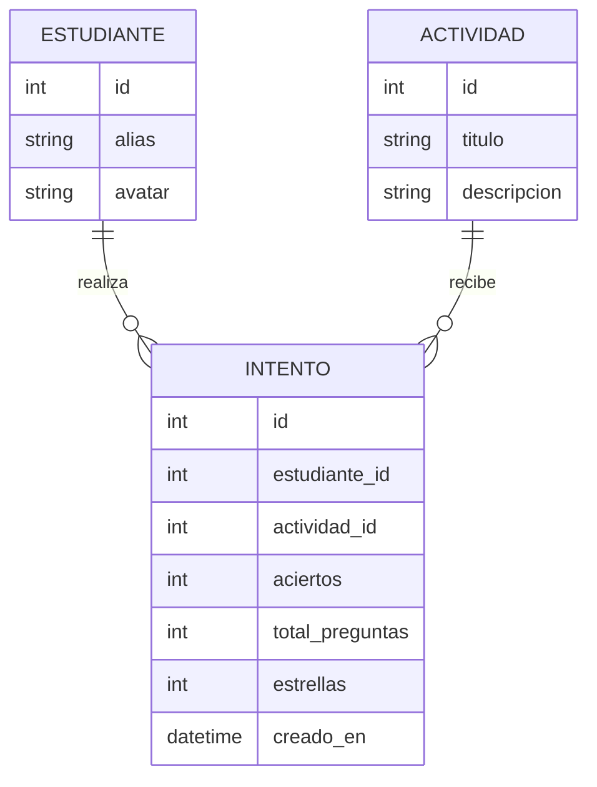

# Plan técnico

## Arquitectura

Mantener las capas existentes: `app/rutas/` valida la petición y delega; `app/servicios/`
implementa la regla de estrellas, progreso y métricas; `app/modelos/` contiene las
entidades SQLModel. No se debe incorporar lógica de puntuación en los endpoints.

## Modelo de datos

`Intento` conserva cada ejecución; no se sobrescribe al repetir. El progreso por actividad
se obtiene tomando el máximo de `estrellas` de los intentos del estudiante, y el total
se calcula sumando esos máximos. No hace falta persistir un total duplicado si puede
derivarse de forma confiable de los intentos.

La regla de estrellas debe vivir en `app/servicios/estrellas.py` y aceptar los aciertos
y el total como entrada. El encargo define que pocas respuestas correctas dan 1
estrella y que una actividad sin errores da 3; no define el criterio para 2 estrellas.
No se deben inventar umbrales adicionales. El servicio valida que el total sea positivo
y que los aciertos estén entre cero y el total antes de guardar el intento.

## Servicios propuestos

- `calcular_estrellas(aciertos, total_preguntas)`: devuelve de 1 a 3 conforme a los
  umbrales acordados.
- `registrar_intento(estudiante_id, actividad_id, aciertos, total_preguntas)`: valida,
  calcula estrellas y persiste un nuevo intento.
- `obtener_progreso(estudiante_id)`: devuelve mejor resultado por actividad y total
  acumulado.
- `obtener_metricas_actividad(actividad_id)`: devuelve número de intentos, repeticiones,
  estrellas por estudiante y frecuencia de repetición para identificar las actividades
  más repetidas.

Las rutas solo traducen los datos HTTP a llamadas del servicio y presentan sus
resultados. La experiencia del estudiante también muestra el total de estrellas y
celebra cada resultado con animación y sonido. Una propuesta de endpoints, para
implementar cuando se apruebe el contrato:
`POST /api/actividades/{actividad_id}/intentos`,
`GET /api/estudiantes/{estudiante_id}/progreso` y
`GET /api/docente/actividades/{actividad_id}/metricas`.

## Contrato de API

| Método | Ruta | Descripción | Respuesta |
| --- | --- | --- | --- |
| GET | /salud | Estado del servicio | 200 |
| POST | /api/actividades/{actividad_id}/intentos | Registrar un intento | Pendiente de diseño |
| GET | /api/estudiantes/{estudiante_id}/progreso | Consultar mejores resultados y total | Pendiente de diseño |
| GET | /api/docente/actividades/{actividad_id}/metricas | Consultar métricas agregadas | Pendiente de diseño |

## Decisiones

Cada decisión importante se registra como ADR en `specs/adr/`. El criterio de 2 estrellas
es una decisión pendiente y no debe codificarse como una suposición.
